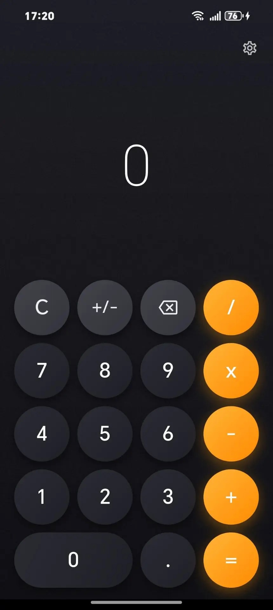

# eCalc

Современный калькулятор с минималистичным дизайном, написанный на Flutter.

<p align="center">
  
</p>

## Возможности

### Дизайн
- Тёмная тема с градиентным фоном
- Тонкая текстура шума для устранения визуальных артефактов (banding)
- Анимации нажатия кнопок
- Подсветка активного оператора

### Функциональность
- Поддержка цепочек операций (2 + 3 + 4 = 9)
- Строка выражения над результатом
- Смена знака числа (+/-)
- Контроль точности вычислений

### Настройки
- Виброотклик при нажатии кнопок
- Включение/отключение строки выражения
- Выбор темы (светлая/тёмная/системная)
- Настройка количества знаков после запятой (слайдер от 0 до 10)
- Информация о версии приложения
- Ссылка на исходный код

### Техническое
- Работа на Android и iOS
- Горячая перезагрузка во время разработки
- Поддержка hot reload и hot restart

## Установка

### Требования

- Flutter SDK 3.x или новее (stable channel)
- Android Studio или Xcode (для сборки под конкретную платформу)
- Git

### Шаги установки

1. Клонируйте репозиторий:

```bash
git clone https://github.com/Yarik528/ecalc.git
cd ecalc
```

2. Установите зависимости:

```bash
flutter pub get
```

3. Запустите приложение:

```bash
flutter run
```

Для сборки релизной версии:

```bash
flutter build apk --release
```

Готовый APK будет находиться в `build/app/outputs/flutter-apk/app-release.apk`.